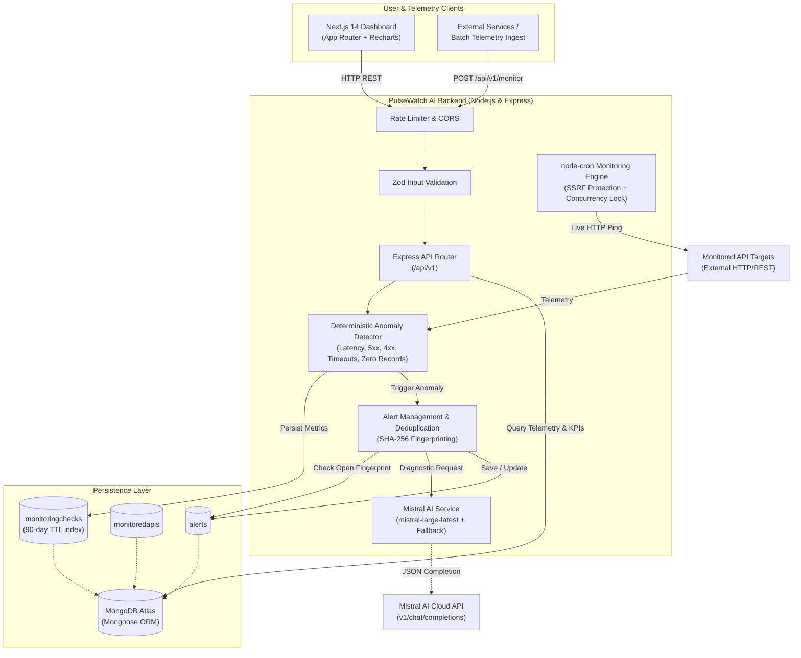

# PulseWatch AI — Intelligent API Monitoring & Alert System

> Production-minded, autonomous API monitoring and observability platform with deterministic anomaly detection, fingerprint deduplication, and automated root-cause diagnostics powered by Mistral AI.

---

## 1. System Architecture



---

## 2. Technology Stack

| Layer | Technology | Purpose |
|---|---|---|
| **Frontend** | Next.js 14 (App Router), React, JavaScript | Observability UI with client-side polling and responsive layouts |
| **Styling** | Tailwind CSS, Lucide React | Modern dark-mode SaaS design system |
| **Visualizations** | Recharts | Time-series latency area charts and status code bar charts |
| **Backend** | Node.js, Express.js (CommonJS) | Scalable REST API with centralized error and async handling |
| **Database** | MongoDB Atlas, Mongoose | Schema validation, compound indexes, and 90-day TTL pruning |
| **AI Diagnostics** | Mistral AI (`mistral-large-latest`) | Root-cause diagnosis, impact assessment, and remediation checklists |
| **Validation** | Zod | Runtime type safety for environment and all HTTP inputs |
| **Logging** | Pino & Pino-HTTP | High-throughput structured JSON logging with credential redaction |
| **Scheduler** | node-cron | Dynamic interval scheduling with SSRF guards and lock sets |
| **Testing** | Jest, Supertest | Unit, integration, and end-to-end lifecycle verification |

---

## 3. Key Features

- **Multi-Vector Anomaly Detection (No-LLM Core):** Evaluates latency thresholds, HTTP 5xx server errors, HTTP 4xx client errors, timeouts, network connectivity drops, invalid data, and empty record sets under expected-record policies.
- **Fingerprint-Based Alert Deduplication:** Computes stable SHA-256 hashes (`identifier:primaryReasonCode`) to update ongoing alerts, escalate severity, increment occurrence counters, and eliminate notification spam.
- **Resilient AI Diagnostics:** Mistral AI synthesizes telemetry into root causes, operational impacts, and step-by-step remediation checklists. If Mistral is throttled (HTTP 429) or offline, the deterministic fallback engine takes over with zero downtime.
- **SSRF Defense:** Monitoring engine blocks `localhost`, private subnets (`10.0.0.0/8`, `172.16.0.0/12`, `192.168.0.0/16`), IPv6 loopbacks, and unsafe redirect chains in production.
- **Interactive Observability Dashboard:** Real-time KPI summaries, latency trend charts, target endpoint CRUD, incident triage state transitions (`open` → `acknowledged` → `resolved`), and check history search.

---

## 4. Repository Structure

```
API_Monitoring_Alert_System/
├── backend/
│   ├── src/
│   │   ├── config/             # env.js (Zod), database.js, logger.js (Pino)
│   │   ├── middleware/         # errorHandler.js, notFound.js, rateLimiter.js
│   │   ├── models/             # MonitoredAPI.js, MonitoringCheck.js, Alert.js
│   │   ├── modules/
│   │   │   ├── alerts/         # Controller, schema, routes
│   │   │   ├── monitored-apis/ # Controller, schema, routes
│   │   │   └── monitoring/     # Ingest controller, history, summary, routes
│   │   ├── services/           # anomalyDetector.js, alertService.js, mistralService.js, monitoringEngine.js
│   │   ├── utils/              # apiResponse.js, asyncHandler.js, seedData.js
│   │   ├── app.js              # Express app setup & middleware pipeline
│   │   └── server.js           # DB connector, scheduler init & graceful shutdown
│   ├── tests/                  # 11 Jest test suites (82 passing tests)
│   └── package.json
├── frontend/
│   ├── src/
│   │   ├── app/                # Next.js App Router pages (/, /apis, /alerts, /alerts/[id], /history, /settings)
│   │   ├── components/         # AppShell, Sidebar, Header, SummaryCard, Badges, Charts, Dialogs
│   │   └── lib/                # api.js (Axios API client)
│   ├── tailwind.config.js
│   └── package.json
├── sample-data/
│   ├── demo-monitoring-checks.json
│   └── sample-apis.json
├── .gitignore
└── README.md
```

---

## 5. Local Setup & Installation (Windows PowerShell)

### Prerequisites
- Node.js >= 18.0.0
- npm >= 9.0.0
- MongoDB Atlas connection string (or local MongoDB on port 27017)
- Mistral AI API key (obtain from [console.mistral.ai](https://console.mistral.ai/))

### Step 1: Clone and Configure Backend
```powershell
cd e:\Development\API_Monitoring_Alert_System\backend

# Copy environment template
Copy-Item .env.example .env

# Install backend dependencies
npm install
```

Open `backend/.env` and update with your actual credentials:
```env
PORT=5000
NODE_ENV=development
MONGODB_URI=mongodb+srv://<username>:<password>@cluster.mongodb.net/pulsewatch?retryWrites=true&w=majority
FRONTEND_URL=http://localhost:3000
MISTRAL_API_KEY=your_actual_mistral_api_key_here
MISTRAL_MODEL=mistral-large-latest
DEFAULT_CHECK_INTERVAL_SECONDS=60
DEFAULT_TIMEOUT_MS=10000
DEFAULT_RESPONSE_TIME_THRESHOLD_MS=2000
DEFAULT_ERROR_RATE_THRESHOLD_PERCENT=10
```

### Step 2: Configure Frontend
```powershell
cd e:\Development\API_Monitoring_Alert_System\frontend

# Copy environment template
Copy-Item .env.example .env.local

# Install frontend dependencies
npm install
```

Verify `frontend/.env.local`:
```env
NEXT_PUBLIC_API_URL=http://localhost:5000/api/v1
NEXT_PUBLIC_API_BASE_URL=http://localhost:5000/api/v1
```

### Step 3: Seed Sample Data (Optional)
To populate realistic monitored APIs, check telemetry, and incidents:
```powershell
cd e:\Development\API_Monitoring_Alert_System\backend
npm run seed
```

### Step 4: Run Development Servers
In Terminal 1 (Backend):
```powershell
cd e:\Development\API_Monitoring_Alert_System\backend
npm run dev
# Server starts on http://localhost:5000
```

In Terminal 2 (Frontend):
```powershell
cd e:\Development\API_Monitoring_Alert_System\frontend
npm run dev
# Dashboard opens on http://localhost:3000
```

---

## 6. Running Tests & Code Quality

### Backend Test Suite (Jest + Supertest)
Runs 11 test suites covering 82 unit, integration, and E2E flow tests:
```powershell
cd e:\Development\API_Monitoring_Alert_System\backend
npm test
```

### Frontend Build & Lint Verification
```powershell
cd e:\Development\API_Monitoring_Alert_System\frontend
npm run lint
npm run build
```

---

## 7. API Reference & Examples

### Health Check
`GET /api/v1/health`
```bash
curl -X GET http://localhost:5000/api/v1/health
```
```json
{
  "success": true,
  "message": "PulseWatch AI API is running",
  "data": {
    "status": "healthy",
    "timestamp": "2026-10-22T14:30:00.000Z",
    "environment": "development",
    "version": "1.0.0",
    "database": "connected"
  }
}
```

### Ingest Batch Monitoring Checks
`POST /api/v1/monitor`
```bash
curl -X POST http://localhost:5000/api/v1/monitor \
  -H "Content-Type: application/json" \
  -d '[
    {
      "api_name": "PatientDataAPI",
      "status_code": 200,
      "response_time_ms": 120,
      "records_returned": 25
    },
    {
      "api_name": "BillingGatewayAPI",
      "status_code": 500,
      "response_time_ms": 450,
      "records_returned": 0,
      "error_message": "Internal Server Error"
    }
  ]'
```
```json
{
  "success": true,
  "message": "Monitoring checks processed",
  "data": {
    "processed": 2,
    "anomaliesDetected": 1,
    "alerts": ["6717a0b3..."],
    "results": [
      {
        "api_name": "PatientDataAPI",
        "anomalyDetected": false,
        "checkId": "6717a0b3..."
      },
      {
        "api_name": "BillingGatewayAPI",
        "anomalyDetected": true,
        "checkId": "6717a0b4...",
        "severity": "critical",
        "reasonCodes": ["HTTP_5XX"],
        "alertId": "6717a0b5..."
      }
    ]
  }
}
```

### Query Dashboard Summary
`GET /api/v1/monitoring/summary`
```bash
curl -X GET http://localhost:5000/api/v1/monitoring/summary
```
```json
{
  "success": true,
  "data": {
    "apis": { "total": 5, "active": 4, "inactive": 1 },
    "metrics24h": {
      "totalChecks": 120,
      "successfulChecks": 115,
      "failedChecks": 5,
      "uptimePercent": 95.83,
      "avgResponseTimeMs": 240
    },
    "alerts": {
      "totalActive": 2,
      "bySeverity": { "critical": 1, "high": 0, "medium": 0, "warning": 1, "low": 0 },
      "recent": [...]
    }
  }
}
```

### Triage / Resolve Alert
`PATCH /api/v1/alerts/:id`
```bash
curl -X PATCH http://localhost:5000/api/v1/alerts/6717a0b5... \
  -H "Content-Type: application/json" \
  -d '{"status": "resolved"}'
```

---

## 8. Deterministic Demo Scenarios

Test how PulseWatch AI handles common API reliability scenarios:

| Scenario | Payload Characteristics | Anomaly Flags | System Action |
|---|---|---|---|
| **Healthy API** | `status_code: 200`, `response_time_ms: 110`, `records: 50` | None | Telemetry recorded clean; no alert triggered. |
| **Degraded Latency** | `status_code: 200`, `response_time_ms: 2800` | `HIGH_LATENCY` (warning) | Warning alert created or deduplicated. |
| **Server Outage** | `status_code: 500`, `response_time_ms: 220` | `HTTP_5XX` (critical) | Critical alert raised; Mistral analyzes logs and produces root-cause steps. |
| **Zero Records** | `status_code: 200`, `records_returned: 0`, `expectRecords: true` | `ZERO_RECORDS` (medium) | Triggers alert due to strict zero-record policy violation. |
| **Network Timeout** | `status_code: 504`, `error_message: "ETIMEDOUT"` | `REQUEST_TIMEOUT`, `HTTP_5XX` | High-priority alert triggered with timeout diagnostics. |

---

## 9. Production Deployment Guide

### Deployment Architecture
- **Database:** MongoDB Atlas M0/M10 Cluster
- **Backend API:** Render Web Service (Node.js)
- **Frontend Dashboard:** Vercel (Next.js App Router)

### Step 1: MongoDB Atlas Setup
1. Create a free M0 cluster on [MongoDB Atlas](https://www.mongodb.com/cloud/atlas).
2. Under **Database Access**, create a user `pulsewatch-admin` with a strong password.
3. Under **Network Access**, allow Render IP access (or `0.0.0.0/0` with secure credentials).
4. Copy the connection URI:
   `mongodb+srv://pulsewatch-admin:<password>@cluster0.mongodb.net/pulsewatch?retryWrites=true&w=majority`

### Step 2: Backend Deployment on Render
1. Create a new **Web Service** on [Render](https://render.com) connected to your repository.
2. Configure settings:
   - **Root Directory:** `backend`
   - **Environment:** `Node`
   - **Build Command:** `npm install`
   - **Start Command:** `npm start`
   - **Health Check Path:** `/api/v1/health`
3. Add Environment Variables:
   - `PORT`: `5000`
   - `NODE_ENV`: `production`
   - `MONGODB_URI`: `<Your MongoDB Atlas URI>`
   - `FRONTEND_URL`: `https://pulsewatch-frontend.vercel.app`
   - `MISTRAL_API_KEY`: `<Your Mistral AI Key>`
   - `MISTRAL_MODEL`: `mistral-large-latest`
4. Deploy the service and record the live URL (e.g., `https://pulsewatch-api.onrender.com`).

### Step 3: Frontend Deployment on Vercel
1. Import repository on [Vercel](https://vercel.com).
2. Configure settings:
   - **Framework Preset:** `Next.js`
   - **Root Directory:** `frontend`
   - **Build Command:** `npm run build`
   - **Output Directory:** `.next`
3. Add Environment Variables:
   - `NEXT_PUBLIC_API_URL`: `https://pulsewatch-api.onrender.com/api/v1`
   - `NEXT_PUBLIC_API_BASE_URL`: `https://pulsewatch-api.onrender.com/api/v1`
4. Click **Deploy**. Update `FRONTEND_URL` on Render if your final Vercel domain differs.

---

## 10. Security & Threat Mitigation Summary

- **SSRF Defenses:** Validates all registered URLs; explicitly rejects loopback, RFC1918 private subnets, link-local addresses, and malicious redirect chains in production.
- **Credential Protection:** Mistral API keys and MongoDB connection URIs are validated on boot with Zod, stored exclusively in server environment variables, and redacted from Pino output.
- **Prompt Injection Defense:** Telemetry payload sent to Mistral is sanitized into a strict diagnostic observation structure. System prompts treat incoming telemetry as untrusted data, never instructions.
- **Resource Limits:** Body sizes capped at 10kb; rate limiting applied across `/api/` (100 req/15min); node-cron concurrency sets prevent check overlap.
- **Lifecycle Integrity:** State transitions enforced via validated state machine (`open` → `acknowledged` → `resolved`); resolved alerts cannot be reopened.

---

## 11. Known Limitations & Roadmap

- **Multi-Tenant Workspaces:** Current architecture is single-tenant. Future iterations will introduce organization tenancy with role-based access control (RBAC).
- **External Webhook Dispatches:** Alerts are currently managed in-app; integration with Slack, PagerDuty, and email webhooks is planned.
- **Distributed Scheduler:** Cron tasks run in-memory; for multi-instance horizontal scaling, a distributed queue like BullMQ with Redis will coordinate checks.

---

## License

MIT © 2026 PulseWatch AI.
